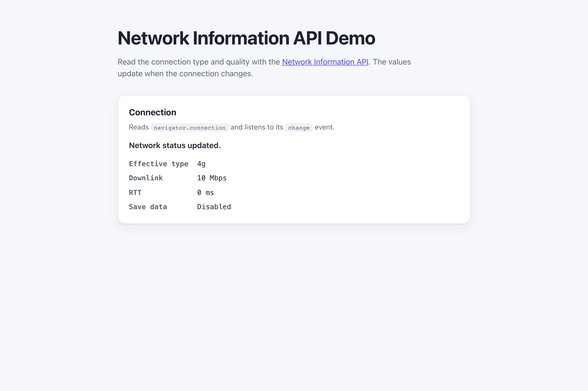

# WebSharper.NetworkInformation

[](https://github.com/dotnet-websharper/NetworkInformationAPI)

WebSharper bindings for the [Network Information API](https://developer.mozilla.org/en-US/docs/Web/API/Network_Information_API) —
reading the network status and connection quality from F# and C# web apps.

This repository contains:

| Project | Purpose |
| --- | --- |
| `WebSharper.NetworkInformation` | The binding: WIG definitions for `NetworkInformation` (`downlink`, `downlinkMax`, `effectiveType`, `rtt`, `saveData`, `type`, and the `change` event). |
| `WebSharper.NetworkInformation.Extensions` | `[<Inline>]` client extensions: `Navigator.Connection`. |
| `WebSharper.NetworkInformation.Sample` | An ASP.NET Core SPA that shows the connection type and quality. |

## Live demos

**Try it live:** [Open the sample in your browser](https://dotnet-websharper.github.io/NetworkInformationAPI/)



The sample doubles as the binding's test case: it reads `navigator.connection` and listens for the `change` event.

- **Sample (this repository):** <https://dotnet-websharper.github.io/NetworkInformationAPI/>
- **Source repository:** <https://github.com/dotnet-websharper/NetworkInformationAPI>
- **WebSharper bindings:** <https://websharper.com/bindings>

## Features

- `NetworkInformation.effectiveType` (`slow-2g`, `2g`, `3g`, `4g`).
- `NetworkInformation.downlink` / `downlinkMax` / `rtt` / `saveData` / `type`.
- The `change` event through `NetworkInformation.OnChange`.
- `Navigator.connection` in the Extensions assembly.

## Installation

The binding is not currently published to NuGet. Reference the projects from source:

```bash
git clone https://github.com/dotnet-websharper/NetworkInformationAPI.git
```

```xml
<ItemGroup>
  <ProjectReference Include="path/to/WebSharper.NetworkInformation/WebSharper.NetworkInformation.fsproj" />
  <ProjectReference Include="path/to/WebSharper.NetworkInformation.Extensions/WebSharper.NetworkInformation.Extensions.fsproj" />
</ItemGroup>
```

## Usage

```fsharp
namespace WebSharper.NetworkInformation.Demo

open WebSharper
open WebSharper.JavaScript
open WebSharper.NetworkInformation

[<JavaScript>]
module Demo =
    let connection = JS.Window.Navigator.Connection

    let read () =
        Console.Log($"Effective type: {connection.EffectiveType}")
        Console.Log($"Downlink: {connection.Downlink} Mbps")
        Console.Log($"RTT: {connection.Rtt} ms")
        Console.Log($"Save data: {connection.SaveData}")

    connection.OnChange <- fun _ -> read ()
```

The `Navigator.Connection` extension is declared in the Extensions assembly. `NetworkInformation.OnChange` is the
non-obsolete `onchange` handler; the obsolete `onchange` overload remains for compatibility.

## Running the sample

Build the sample in Release and serve its static output:

```bash
dotnet build WebSharper.NetworkInformation.Sample/WebSharper.NetworkInformation.Sample.fsproj -c Release
python3 -m http.server -d WebSharper.NetworkInformation.Sample/wwwroot 8099
```

Open <http://localhost:8099/> to see the connection type, downlink speed, RTT, and save-data mode.

Alternatively, run the ASP.NET Core host:

```bash
dotnet run --project WebSharper.NetworkInformation.Sample
```

## Building from source

### Prerequisites

- [.NET SDK 10](https://dotnet.microsoft.com/download) or later.

### Build

```bash
dotnet build WebSharper.NetworkInformation.sln -c Release
```

The binding projects target `netstandard2.0`; the sample targets `net10.0`.

## Deployment

Pushing to `main` triggers `.github/workflows/ghpages.yml`, which builds the sample in Release and publishes
`WebSharper.NetworkInformation.Sample/wwwroot` to the `gh-pages` branch.

## Repository layout

```
WebSharper.NetworkInformation/              # binding (WIG definitions)
  Main.fs
WebSharper.NetworkInformation.Extensions/   # [<Inline>] client extensions
  Library.fs
WebSharper.NetworkInformation.Sample/       # ASP.NET Core SPA demo
  Client.fs
  Startup.fs
  wwwroot/
    index.html
    site.css
.github/workflows/ghpages.yml               # build + deploy the sample to GitHub Pages
```

## Notes on the API

- **Availability:** `navigator.connection` is not available in every browser. Check for `null` and degrade
  gracefully.
- **Accuracy:** `downlink`, `rtt`, and `effectiveType` are estimates. They are hints for adaptivity, not exact
  measurements.
- **Change events:** the `change` event fires when the network conditions change. Assign `connection.OnChange` to
  a handler.
- **Privacy:** the API is subject to privacy restrictions; some values may be rounded or unavailable.

## License

Apache 2.0 — see [LICENSE.md](LICENSE.md).
